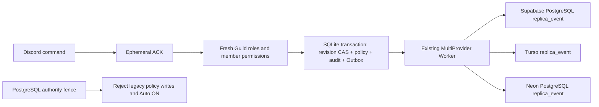

# Spam Protection: SQLite権威ストアとMulti-DB複製

この変更はDraftの移行候補です。ProductionへのMigration、設定変更、再起動、デプロイは実施していません。

## 監査で確認した境界

監査基点はGitHub `main` の `7088dd4`。`/spamprotection level` は `guildSpamPolicyCache` を経由してNeonを読み、`SAVE_SPAM_POLICY_COMMAND_SQL` の単一CTEで設定と監査を書いていました。Neon停止時は設定変更不能で、変更コマンドにはDBアクセス前のACKもありませんでした。Web PUTはPostgreSQLトランザクションで同じ設定と監査を更新しており、Botだけを別DBへ切り替えると二重の権威が生じます。

`lib/storage` はWAL SQLite、`lib/sync` はSupabase/PostgreSQL・Turso・Neonの既存アダプター、Provider別Delivery、Retry、Circuit、DLQを備えています。`local_guild_config` は最終既知値のキャッシュであり、権威ストアへ暗黙昇格させません。Security監査とOutboxはすでにSQLiteトランザクションで結ばれています。

読み取り専用のSSH確認では、`~/NuviloView-bot` は旧 `413a03d`、`~/NuviloView-release-7088dd4` は `7088dd4` でした。後者には実行データ用の未追跡ディレクトリがあります。ディレクトリ名だけで稼働プロセス・正しいSQLiteパスを判断してはいけません。本番DBの全17 Guildの値は今回再取得していません。移管時には実際の値をロック内で再検証します。

## データの権威

| データ | 更新先・判断元 | クラウド複製の扱い |
| --- | --- | --- |
| 移管前の検知設定 | 従来のNeon/PostgreSQL | 障害時の別DB書込み禁止 |
| 明示移管後の検知設定 | 指定した単一SQLiteとwriter ID | 非同期の監査イベント複製。権威へ自動昇格しない |
| Auto Timeout同意・緊急停止 | 既存Security Engine v2のPostgreSQL制御 | キャッシュ・複製を実行許可に使用しない |
| SQLite権威モードでの自動処罰 | 常時OFF | `/auto on` は有効化しない。PGにもONを拒否するFence |
| OAuth、セッション、管理者設定、Operator権限 | 各既存サービスの権威 | ローカル検知設定の移管対象外 |
| 監査・同期イベント | SQLite内で設定変更と同時Commit | 同一Event ID・Checksumで既存Workerが各Providerへ配送 |

本変更は「検知設定をNeon停止中にも変更できる」経路を実装します。クラウド依存機能すべてのオフライン化や、同意・認証のMulti-Master化ではありません。移管後のWebは旧設定を現行値として返さず、409とDiscordでの変更案内を返します。WebからSQLiteへ直接書く秘密の迂回経路は設けません。

## 保存・競合・権限

`SPAM_POLICY_AUTHORITY=sqlite` と固定 `SPAM_POLICY_WRITER_ID` が明示された場合だけローカル経路が有効です。未指定時は従来の経路です。切替は障害検知で自動実行しません。SQLiteが無効、読取り専用、未Import、別writer、Checksum不整合なら拒否します。

権威状態は既存 `sync_metadata` の専用名前空間 `spam-policy-authority:v1:<guildId>` に保存します。キャッシュ、Circuit状態、他ドメインのキーとは分離しています。SQLiteに新しいテーブルMigrationは追加しません。Botの権威接続は `synchronous=FULL`、WAL、`BEGIN IMMEDIATE` を使用します。

PostgreSQL側の設定・同意変更はREAD COMMITTEDを要求します。Repeatable Readなどの古いSnapshotでは後から作成したFenceを見落とす可能性があるため拒否します。移管ツールは表ロック取得後に、3個のFence Triggerの対象・イベント種別・有効状態を検査します。Fence表だけが存在する不完全なMigrationや、Triggerが無効な状態では移管しません。

各変更にはwriter ID、移管epoch、単調増加revision、正規化JSONのSHA-256を付けます。Discord Interaction IDは冪等キーです。同じリクエストの再配送は再適用せず、内容の異なるID再利用や古いrevisionは拒否します。時刻ベースのLast-Write-Wins、Provider間の投票、古い複製からの上書きは行いません。

設定・before/after監査・Outbox・Provider Deliveryは同一SQLiteトランザクションです。一つでも失敗したら全体をRollbackします。ACKの成功は保存成功ではなく、保存Commit後の編集返信が保存結果です。返信だけ失敗してもInteraction再配送は設定を二重変更しません。

Botは初期応答のGuild権限を確認し、書込み直前にGuild Role一覧とメンバーを再取得します。再取得失敗・権限失効は拒否します。Guild IDを全検索・更新キーに含めます。検知強度の変更は自動処罰の同意を付与せず、SQLiteモードの処罰経路は2箇所とも実行不可にします。Webの既存セッション、Guild認可、CSRF、Rate Limitは維持します。

## レプリケーションと障害

`security` ドメインの `spam_policy_authority_v1` イベントを既存のOutboxへ渡します。既存アダプターは `replica_event` に冪等保存し、各Providerの配送結果を独立管理します。設定イベントの順序が前後して届いても実行設定を更新するConsumerはなく、復旧検証にはepochとrevisionを使います。同一Event IDで異なるChecksumは既存の競合処理へ渡し、人が調査するまで自動採用しません。

Supabase/Tursoは既存ポリシーの必須複製、Neonは任意複製です。設定Commitはこれらの応答を待ちません。設定権威イベントは通常のOutbox期限削除から除外します。必須複製が完了しても、長期間停止した任意Neon向けの履歴・Deliveryを消しません。監査履歴のアーカイブは別途照合を伴う作業とし、自動削除を追加していません。容量とProvider別Retry/DLQを監視してください。

| 障害 | 挙動 |
| --- | --- |
| 移管前にNeon停止 | 変更拒否、早期ACK後に失敗通知。未検証キャッシュへ移管しない |
| 移管後に全クラウド停止 | SQLiteへ原子的保存、Outbox保持、クラウド依存機能は縮退 |
| SQLiteのBusy、容量不足、破損 | 設定変更拒否。クラウドへ代替書込みしない |
| PostgreSQL Fence Commit後にImport失敗 | PGは封鎖したまま。同じplanで再開。自動Fence解除なし |
| Provider復旧 | 既存WorkerのRetry/照合。恒久失敗はDLQの既存手順で調査 |
| 分散SingletonのNeon Leaseを確認不能 | 既存Fail-Closedを維持し、別ホストを起動しない |

複数ホストでコピーしたSQLiteを同時稼働させる構成は非対応です。writer IDは分散Leaseの代用品ではありません。既存のSingleton/プロセス管理を維持し、単一ホスト運用への変更にも明示的な運用レビューが必要です。

## 承認後に実施する移管手順

以下は本番実施済みの記録ではありません。今回の依頼はDraft PRまでです。

1. 稼働リリース、Bot/Workerの実パス、既存SQLiteの絶対パス、現在のGuild一覧を確認する。秘密値をログへ出さず、SQLiteとNeonのバックアップを別媒体に保管し復元確認する。Bot、Worker、Webを含めて書込みを止め、処理中コマンドをDrainする。既存SQLiteやOutboxを削除・初期化しない。
2. `20261022-spam-policy-authority` を既存Migration runnerで計画・レビューする。高リスク承認が必要なschema-only Migrationで、Guildの移管は行わない。Runtime RoleにFence表のSELECTのみを付与し、変更権限・TRUNCATE・トリガー無効化権限を与えない。Fence作成は専用の移管Roleで行う。
3. 実在する17 Guildの文字列ID、固定writer ID、一意のepoch、接続先の `databaseHost` と `databaseName` をJSON planに記録する。数字IDをJSON Numberにしない。実データを公開リポジトリへ追加しない。
4. `node scripts/cutover-spam-policy.mjs --plan=/absolute/reviewed-plan.json` で計画だけ確認する。計画モードはDBを開かない。既存SQLiteは現在のローカルschema versionとIntegrityが正常であることを要求する。
5. 明示承認後だけ、対象接続の `DATABASE_URL`、既存の絶対 `LOCAL_STORAGE_PATH`、`LOCAL_STORAGE_ENABLED=true`、`LOCAL_STORAGE_WRITE_ENABLED=true`、`SPAM_POLICY_CUTOVER_APPROVED=<planのepoch>` を安全な環境に設定する。`SECURITY_V2_AUTO_EXECUTION=enabled` は許容しない。`--execute-fenced-cutover` を追加して実行する。
6. ツールはPostgreSQL内で表ロックを取り、全17 GuildのEnrollment complete・Auto Timeout OFFを検証する。保存済み設定が欠落していた形跡があれば停止する。設定SnapshotとFenceを同時Commitし、その後に既存SQLiteへImportする。OFFや既存同意を更新するSQLは実行しない。既存監査行も削除しない。
7. 指定writerのBot環境に `SPAM_POLICY_AUTHORITY=sqlite` を設定する。Provider接続先と既存Multi-DBフラグを検証し、承認された通常のリリース手順で起動する。コードだけをMergeしても移管は完了しない。全GuildのImportとOFF、ローカル設定と監査、各Providerの配送を確認する。

Neon障害中に初回移管を実行することはできません。権威の読取り・封鎖・全17 GuildのOFFを確認できないためです。Neonを復旧するか、検証可能なバックアップと旧writerの確実な停止を伴う別の承認済み移行が必要です。このツールは推測で移管しません。

## 復旧・戻し方

Import途中の停止は同じplanで再実行します。PostgreSQLに保存したSnapshotを再使用し、既に進んだSQLite revisionをImportでリセットしません。writer ID・epoch・Seed Checksumが異なれば停止します。Import APIは運用者向け内部処理であり、`fenced:true` のJSONを外部リクエストから受け取るAPIはありません。

SQLite喪失・古いバックアップ復元時はBotを停止したまま、バックアップ・監査・保持Outbox・各複製のepoch/revision/Checksumを照合します。低いrevisionを使った運転再開や初期SeedだけのImportを復元完了と扱ってはいけません。履歴の欠落・同一revisionの不一致は要調査です。クラウド複製からの自動Restore/昇格、時刻だけでの勝者選択は実装しません。

移管後のコードロールバックでもPG Fenceは残します。旧コードが設定を保存できない状態は安全側の結果です。PGを権威へ戻すには、SQLite側writerの停止、最新設定と監査の移送・照合、新epochの承認、Fenceの扱いを含む個別手順が必要です。Fence削除やAuto Timeout ONをリリース失敗時の自動処理にしてはいけません。

## 隔離検証

本番資格情報を使わず、メモリ/一時SQLiteとlocalhost専用PostgreSQLで検証します。

- `tests/spam-policy-authority.test.mjs`: 17 Guild分離、OFF保持、CAS、Interaction冪等性、監査/Outbox失敗時Rollback、再起動、再Import、破損・別writer・権限失効、実ハンドラーのNeon非依存更新と早期ACK。
- `tests/helpers/spam-authority-postgres.mjs`: 実PostgreSQL Fence、待機中の旧writer、Insert/Update/Delete/主キー変更/Truncate拒否、Auto ON拒否、再開、ON状態の移管拒否、Neon/Supabaseアダプターでの実イベント保存。
- `tests/multi-db-sync.test.mjs`: 既存Worker、実Tursoアダプターと隔離SQLiteトランスポート、Neon障害・独立配送・復旧、任意Provider停止中の履歴保持。
- `tests/security-v2-consent.test.mjs`: SQLiteモードでクラウド側に古いONがあってもDiscord自動Timeoutを実行しないこと。

実Supabase/Turso/Neonへのネットワーク書込み、Discord実表示、Productionの移管は未実施です。Draftのリリース判定では、それらを隔離DB試験と区別してください。

設計で参照した一次資料: [Discord Interaction応答](https://docs.discord.com/developers/interactions/receiving-and-responding)、[SQLite Transaction](https://www.sqlite.org/lang_transaction.html)、[PostgreSQL Explicit Locking](https://www.postgresql.org/docs/current/explicit-locking.html)。
